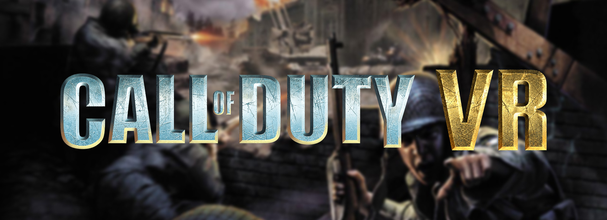

# CALL OF DUTY (2003) VR

[English](README.md) | **Português**

Mod de PC VR para a **campanha single player do Call of Duty 1** (`CoDSP.exe` 1.5). Jogue o original de 2003 no
headset: você olha e se move com o próprio corpo, a arma fica na sua mão, a mira é pelo controle e o HUD e os menus
aparecem numa tela flutuante.

Feito por um apaixonado por Call of Duty. O CoD 1 foi o primeiro FPS que joguei e tenho muito carinho por ele, então
quis vivê-lo de novo em VR.

> **Aviso:** projeto não oficial de fã, sem vínculo com a Activision nem endossado por ela. Call of Duty é uma
> marca registrada da Activision Publishing, Inc. É necessária uma cópia legítima do jogo; nenhum código ou
> arquivo do jogo é incluído ou distribuído (os pacotes opcionais são gerados no seu PC a partir da sua própria cópia).

> [!WARNING]
> **Este projeto está em desenvolvimento.** Bugs e falhas visuais podem acontecer. Relate no
> [Discord](https://discord.com/channels/1561484693881225219/1561485586169331882).

## Requisitos

- Call of Duty (2003) para PC, single player, **versão 1.5** (`CoDSP.exe`).
- Headset de PC VR com controles (testado com Quest pelo Virtual Desktop; Air Link e outros headsets de PC VR devem
  funcionar).
- Um runtime OpenXR **de 32 bits**: Virtual Desktop (VDXR) ou Oculus/Meta. O jogo é um programa de 32 bits.

## Instalação

### Mais fácil: o instalador (recomendado)

1. Baixe o `CoD-VR-Setup.exe` da [última release](https://github.com/lambda-gab/cod1-vr/releases/latest).
2. Execute. Ele acha a pasta do jogo (ou deixa você escolher) e confere se o jogo é a versão 1.5.
3. Escolha se quer esconder as mãos do personagem, deixando só a arma na sua mão (recomendado).
4. Conecte o headset e abra o `CoDSP.exe`.

Execute o instalador de novo para atualizar ou desinstalar. Nas atualizações, as suas configurações do `cod_vr.ini`
são mantidas.

### Manual

1. Extraia o `cod-vr-manual-install.zip` da [última release](https://github.com/lambda-gab/cod1-vr/releases/latest).
2. Copie `opengl32.dll`, `openxr_loader.dll` e `cod_vr.ini` para a pasta do jogo (onde está o `CoDSP.exe`).
3. Conecte o headset e abra o `CoDSP.exe`.

Para desinstalar, apague esses três arquivos. Esconder as mãos e os textos do treinamento para VR precisam do
instalador (ou dos passos nas [informações técnicas](docs/TECHNICAL.pt-BR.md)).

## Controles

Padrão, editáveis em `[Buttons]` no `cod_vr.ini`:

| Controle | Ação |
|---|---|
| Gatilho direito | Atirar (com granada, segure para ver a trajetória e solte para lançar) |
| Grip direito | Usar / pegar |
| Gatilho esquerdo | Mirar (ADS; com luneta, abre o zoom) |
| Grip esquerdo | Segurar a arma com as duas mãos |
| Analógico esquerdo | Andar (relativo à cabeça) |
| Analógico direito | Girar (snap 45°); cima/baixo muda a postura |
| A / B | Pular / recarregar |
| X / Y | Próxima arma / coronhada |
| Clique analógico esquerdo | Objetivos |
| Clique analógico direito | Deitar |
| Menu | Menu do jogo |

Nos menus, aponte com a mão da arma: gatilho clica, B volta, A confirma.

## Configurações

Tudo fica no `cod_vr.ini`, na pasta do jogo, com um comentário em cada opção. Se o jogo estiver em `Program Files`,
abra o editor (Bloco de Notas) como administrador para conseguir salvar. As mais usadas:

- `[Controllers]` `WeaponOffset*`, `WeaponPitch`, `WeaponYaw`: posição e ângulo da arma na mão.
- `[Controllers]` `TwoHandGripHeight`, `AimSmoothing`: empunhadura com duas mãos e suavização da mira.
- `[Controllers]` `MuzzleOffsetRight/Up` e `[MuzzleFlash]`: posição do clarão do disparo, também por arma
  (`thompson=frente direita cima`). São relidas durante o jogo: salve e atire de novo.
- `[VR]` `RoomScale`, `PositionalTracking`, `WorldScale`.
- `[HUD]` e `[Scope]`: tamanho e distância das telas flutuantes, suavização da luneta.
- `[Grenade]`: liga/desliga a trajetória e a opacidade dela.

## Releases

### v1.1.0

- Linha de trajetória da granada: mostra por onde ela vai e onde cai, parando nas paredes e passando pelas janelas.
- Os avisos na tela mostram os botões do controle, e os textos do treinamento que falam de mouse foram reescritos
  para o VR.
- O botão Menu abre o menu do jogo.
- Mira da luneta mais estável (suavização própria durante o zoom, sem flicker).
- Clarão do disparo no cano da arma (Thompson, M1A1 Carbine, Springfield), ajustável por arma.

### v1.0.0

- Primeira versão: o jogo fica jogável em VR (estéreo com rastreamento de cabeça e roomscale, arma na mão, mira pelo
  controle, HUD e menus numa tela flutuante, luneta, instalador).

## Próximos passos

- Correção de falhas visuais (artefatos).
- Suporte ao **United Offensive** (`CoDUOSP.exe`).

## Observações

- **Treinamento, as placas do início:** aponte a mão da arma para cada placa e mova a mão para cima e para baixo até o
  jogo marcar o objetivo como concluído.

## Informações técnicas

Como o mod funciona, como compilar, as notas e as ferramentas de engenharia reversa:
[docs/TECHNICAL.pt-BR.md](docs/TECHNICAL.pt-BR.md).
